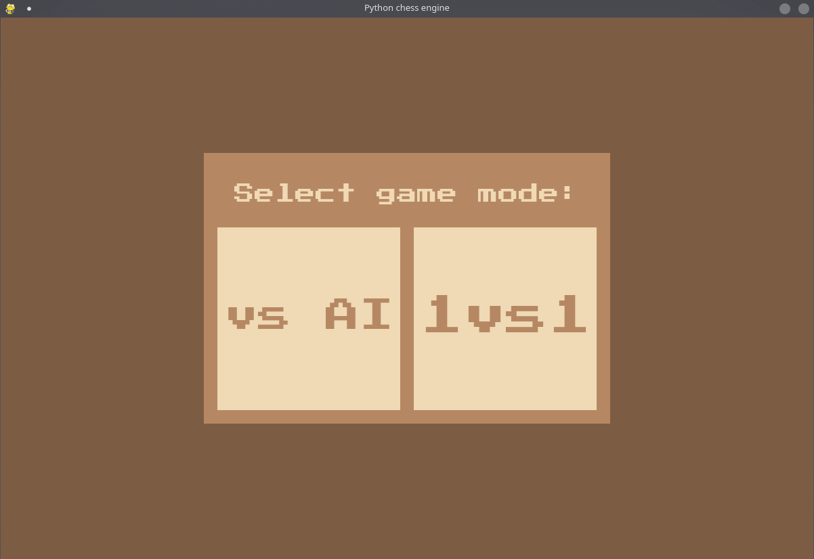
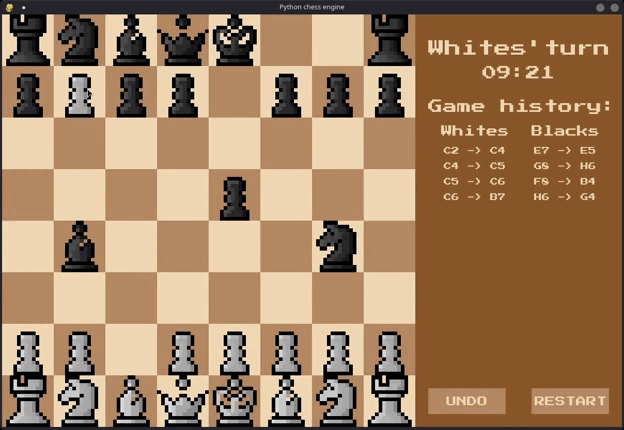

# Python Chess Engine

[](https://www.python.org/)
[](https://www.pygame.org/)
[](LICENSE)

A complete, modular chess engine and graphical interface developed from scratch in Python using Pygame. The project implements standard FIDE rules, strict move and check validation, a customizable chess clock system, and an Artificial Intelligence opponent powered by the Minimax algorithm with alpha-beta pruning and Piece-Square Tables.

Designed with clean software engineering principles in mind, it features strong separation of concerns, Object-Oriented Programming (OOP) paradigms, full state encapsulation for robust move undoing, and comprehensive Google-style documentation across all modules.

<p align="center">
  
  
</p>

---

## Table of Contents

- [Key Features](#key-features)
- [Architecture & Modular Design](#architecture--modular-design)
- [Project Structure](#project-structure)
- [Prerequisites & Installation](#prerequisites--installation)
- [How to Play](#how-to-play)
- [AI Engine Details](#ai-engine-details)
- [Future Improvements](#future-improvements)
- [License](#license)

---

## Key Features

- **FIDE Rules Implementation:**
  - Standard displacement and captures for all 6 piece types.
  - **Castling:** Kingside and queenside castling, ensuring neither king nor rook has moved and verifying the king does not start in check, pass through check, or land in check.
  - **En Passant:** Real-time square tracking for pawn double-steps and diagonal capture execution.
  - **Pawn Promotion:** Interactive selection modal allowing promotion to Queen, Rook, Bishop, or Knight.
- **Game State & Draw Detection:**
  - Real-time Check, Checkmate, and Stalemate evaluation.
  - **50-Move Rule:** Automatic tracking of half-moves without pawn advances or captures.
  - **Threefold Repetition:** Automatic draw detection upon reaching identical board states three or more times under FIDE criteria.
  - **Insufficient Material:** Detection of automatic draws (K vs K, K+B vs K, K+N vs K).
  - Prevention of any move that places or leaves the player's own king in check.
- **Artificial Intelligence (Minimax + Alpha-Beta Pruning):**
  - Player vs Environment (PvE) game mode.
  - Heuristic positional scoring using **Piece-Square Tables (PST)** and piece material values.
  - Alpha-beta pruning to minimize explored search branch space.
- **Robust Move History & Undo System:**
  - Stack-based state snapshots via the `Move` class.
  - Multi-move undo capability (reverting both player and AI moves in PvE, or single turns in PvP) that completely restores board coordinates, captured pieces, moved flags, en passant targets, and clock states.
- **Clock & Timer System:**
  - Dedicated player timers with countdown updates, configurable base time, per-move increments, and timeout detection.
- **Retro-Styled Graphical User Interface:**
  - Rendered with Pygame, featuring square highlighting, custom pixel font typography (`PressStart2P`), interactive sidebar, scrollable move history log, and game-over dialog overlays.

---

## Architecture & Modular Design

The codebase adheres strictly to separation of concerns across 9 dedicated modules:

| Module | Responsibility |
|---|---|
| [`src/pieces.py`](src/pieces.py) | **Polymorphic Pieces:** Base `Piece` class and derived classes (`Pawn`, `Knight`, `Bishop`, `Rook`, `Queen`, `King`). Manages directional vectors, piece values, and 8x8 Piece-Square Tables for heuristic evaluation. |
| [`src/chessboard.py`](src/chessboard.py) | **Board Data Structure:** Encapsulates the 8x8 matrix, piece tracking lists, king position coordinates, en passant target squares, and board-level displacements. |
| [`src/game.py`](src/game.py) | **Game Rules Orchestrator:** Validates move legality against checks, manages turn alternation, tracks draw conditions (50 moves, stalemate, insufficient material, threefold repetition), and executes player moves. |
| [`src/move.py`](src/move.py) | **State Snapshot Model:** Captures move coordinates, the moving piece, captured piece, previous en passant state, moved flags, and clock counters for exact undo reconstruction. |
| [`src/timers.py`](src/timers.py) | **Clock Management:** Implements countdown timers, per-move time increments, timestamp tracking, and formatted `MM:SS` display strings. |
| [`src/ai.py`](src/ai.py) | **Decision Engine:** Minimax implementation with alpha-beta pruning and heuristic evaluation combining material count with positional piece-square matrix weights. |
| [`src/gui.py`](src/gui.py) | **Presentation Layer:** Handles Pygame rendering, texture caching, board drawing, piece blitting, scrollable history tracking, promotion cards, and start menus. |
| [`src/utils.py`](src/utils.py) | **Notation Utilities:** Bidirectional conversions between algebraic chess notation (e.g., `'E4'`) and internal 0-indexed grid coordinates `(4, 4)` with strict validation. |
| [`src/main.py`](src/main.py) | **Main Loop:** Entry point synchronizing event handling, game loop updates, AI execution, and display flipping. |

---

## Project Structure

```text
python-chess-engine/
├── assets/
│   ├── demo/               # Gameplay demonstrations and screenshots
│   │   ├── gameplay.gif
│   │   └── menu.png
│   ├── fonts/              # Custom typography
│   │   └── PressStart2P.ttf
│   └── images/             # High-resolution piece PNG textures
│       ├── BBishop.png, BKing.png, BKnight.png, ...
│       └── WBishop.png, WKing.png, WRook.png, ...
├── src/
│   ├── ai.py               # Minimax & alpha-beta engine
│   ├── chessboard.py       # 8x8 Grid and board state
│   ├── game.py             # Rule validation, turns & draws
│   ├── gui.py              # Pygame UI and event processing
│   ├── main.py             # Application entry point
│   ├── move.py             # Move data model and state snapshot
│   ├── pieces.py           # Piece hierarchy & PST tables
│   ├── timers.py           # Countdown clocks and increments
│   └── utils.py            # Algebraic coordinate conversions
├── LICENSE                 # MIT License
├── README.md               # Project documentation
└── requirements.txt        # Python package dependencies
```

---

## Prerequisites & Installation

### Requirements

- **Python:** 3.10 or higher
- **Pygame:** 2.5+

### Installation Steps

1. **Clone the repository:**
   ```bash
   git clone https://github.com/samuelminambres/python-chess-engine.git
   cd python-chess-engine
   ```

2. **Create and activate a virtual environment (recommended):**
   ```bash
   python3 -m venv venv
   source venv/bin/activate
   # On Windows:
   # venv\Scripts\activate
   ```

3. **Install dependencies:**
   ```bash
   pip install -r requirements.txt
   ```

4. **Run the game:**
   ```bash
   python3 src/main.py
   ```

---

## How to Play

1. **Mode Selection:**
   - Launch the game to open the start menu. Choose between **vs AI** (single-player vs bot) or **1vs1** (local two-player).
2. **Making Moves:**
   - **Click** on any friendly piece to select it. The selected square will be highlighted in blue.
   - **Click** on a valid destination square to complete your move. If you click another friendly piece, the selection will switch to that piece.
3. **Pawn Promotion:**
   - When a pawn reaches the opposite back rank, a card menu will appear. Click on Queen, Rook, Bishop, or Knight to promote.
4. **Sidebar Controls:**
   - **Clock:** Displays the current player's remaining time.
   - **History:** Scroll through past moves using the mouse wheel.
   - **UNDO Button:** Reverts the last move (reverts 2 plies in AI mode to return to your turn, or 1 ply in 1v1 mode).
   - **RESTART Button:** Resets the board, timers, and history to start a new match.

---

## AI Engine Details

The bot uses the **Minimax** adversarial search algorithm enhanced with **Alpha-Beta Pruning**:

- **Search Depth:** Default search depth of 3 plies (configurable in `ChessAI`).
- **Positional Evaluation:**
  Evaluates White material and square values minus Black material and square values:
  $$\text{Score} = \sum_{\text{White}} \left( \text{Value}(p) + \text{PST}(p, x, y) \right) - \sum_{\text{Black}} \left( \text{Value}(p) + \text{PST}(p, x, 7-y) \right)$$
- **Piece-Square Tables (PST):** Each piece type has tailored 8x8 matrices encouraging strategic fundamentals:
  - Pawns advancing towards promotion and controlling central squares.
  - Knights avoiding borders and dominating central outposts.
  - Kings castling and staying shielded behind pawn structures during the middlegame.

---

## Future Improvements

- [ ] **Bitboard Representation:** Accelerate move generation and bitwise operations to allow deeper search depths.
- [ ] **Transposition Tables & Zobrist Hashing:** Cache previously analyzed positions to prevent redundant evaluations.
- [ ] **FEN / PGN Support:** Import and export standard chess notation strings and complete game records.
- [ ] **Opening Book:** Integrate polyglot opening books for fast and varied opening play.

---

## License

This project is licensed under the **MIT License**. See the [LICENSE](LICENSE) file for more information.
